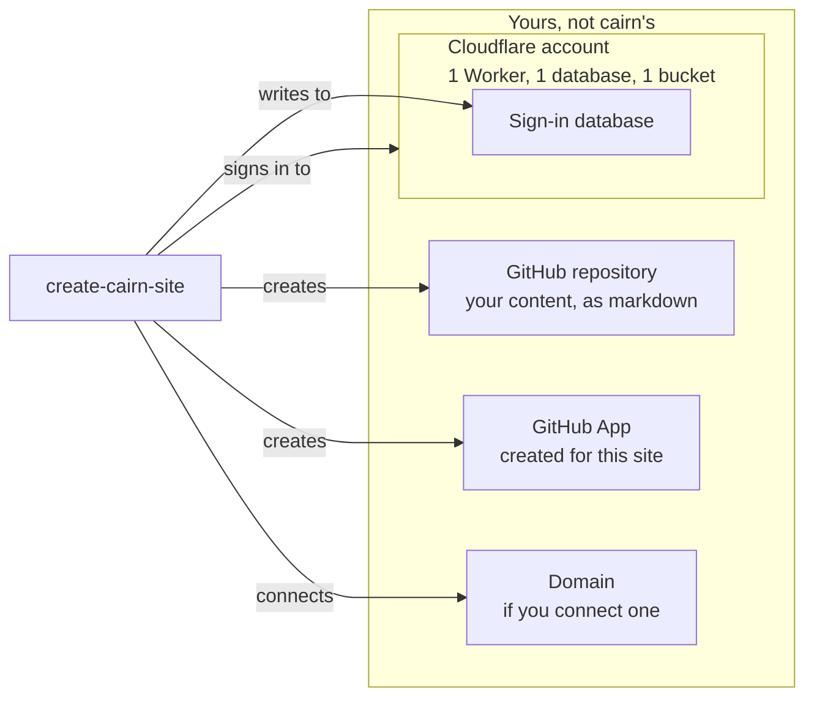

# Before you start

The setup command, `create-cairn-site`, builds a working cairn site from your own GitHub and Cloudflare accounts. This page is for someone deciding whether to set a site up, or inheriting one that someone else set up. It covers what the setup creates, what it costs, what adding a second writer takes, which jobs need a developer, and how to hand the site to a successor. It leaves the setup itself to [Create your site](./create-your-site.md).

## What you end up owning

The setup command creates or connects five things, and each belongs to you.

*The setup command creates or connects each of these once, then holds none of them.*

- Your GitHub repository is private. It holds the site's code and everything anyone writes, which is where your content lives on GitHub.
- A GitHub App commits on your writers' behalf, so nobody needs a GitHub account.
- Your Cloudflare account runs one Worker, which is where your site runs. It also holds one storage bucket for images and one database.
- That one database is the sign-in database, and it records who may sign in.
- A domain joins the list if you connect one.

Every entry is a markdown file in the repository, and no database holds content that only cairn can read. Cloning the repository takes every entry with you. Uploaded images live in the storage bucket, so leaving with everything also means copying the bucket's contents from your Cloudflare account.

## What it costs

Two things cost money, and a third is an admission requirement that costs nothing. The setup command prints the first two before it asks you anything.

- Cloudflare's Workers Paid plan costs $5 a month. A cairn site needs it from its first deploy. Cloudflare bills it once per account, so a second site on the same account adds nothing ([Workers pricing](https://developers.cloudflare.com/workers/platform/pricing/), as of 2026-08-11).
- A domain name costs about $10 to $15 a year for the common endings, and only if you connect your own. You pay your registrar. Cloudflare sells domains at cost and shows the exact price before you pay ([Cloudflare Registrar](https://www.cloudflare.com/products/registrar/), as of 2026-08-11). A domain you already own costs nothing new.
- A Cloudflare API token is free, and you create it yourself. A first run asks for one only if you answer yes to connecting a domain. [Own your domain](./own-your-domain.md) opens Cloudflare's "create token" page with the permissions already selected and asks you to paste the token back.

The plan and a year of domain renewal come to about $6 a month for a small site on its own domain. The database, the storage bucket, and the GitHub repository cost nothing at this size.

One item is unconfirmed. Connecting your domain issues a certificate for it, and Cloudflare doesn't say whether the plan includes that certificate or charges for it as an add-on. Your first bill shows which.

Read every row of the token page before you save it. Cloudflare can render a permission row as an empty control when something goes wrong on its end. The setup command accepts a token that is missing a permission and fails later, at the step that needed it.

## What a second writer needs

Everyone other than you signs in through a link sent to their email address. Sending that mail takes a domain of your own and sign-in email turned on for it. A site that lives only at its `workers.dev` address has no domain to send from.

Workers Paid includes 3,000 outbound emails a month, and Cloudflare charges $0.35 per 1,000 beyond that ([Email Service pricing](https://developers.cloudflare.com/email-service/platform/pricing/), as of 2026-10-31).

Until you add a second writer, you can skip both. Your site works the same either way, and you remain the only person who signs in. [Own your domain](./own-your-domain.md) connects the domain and turns on sign-in email, and [Invite editors](./invite-editors.md) takes over from there.

## What needs a developer

You do everything in the preceding sections yourself, without writing code. Three jobs need a developer:

- Rotating the App's private key, which is a terminal task. See [Rotate the GitHub App key](../extend/rotate-the-github-app-key.md).
- Taking a new cairn release. See [Upgrade cairn](../extend/upgrade-cairn.md).
- Adding anything cairn doesn't ship, such as a custom admin screen or a second sign-in group. The [extend track](../extend/README.md) covers that, and it is the link to hand a developer.

[Check that your site works](./is-it-working.md) routes several more conditions to a developer. Most of them appear only on a site that someone has customized or built by hand, and that page says which is which.

## Hand the site to a successor

Two accounts hold everything: GitHub and Cloudflare. To hand the site over, give the successor access in three places:

1. In GitHub, add them as a collaborator on the repository.
2. In Cloudflare, add them as a member of your account.
3. In the admin, add them as an owner. [Invite editors](./invite-editors.md) shows how.

## See also

- [Create your site](./create-your-site.md) runs the setup.
- [Own your domain](./own-your-domain.md) connects a domain and turns on sign-in email.
- [Check that your site works](./is-it-working.md) explains each readiness result.
