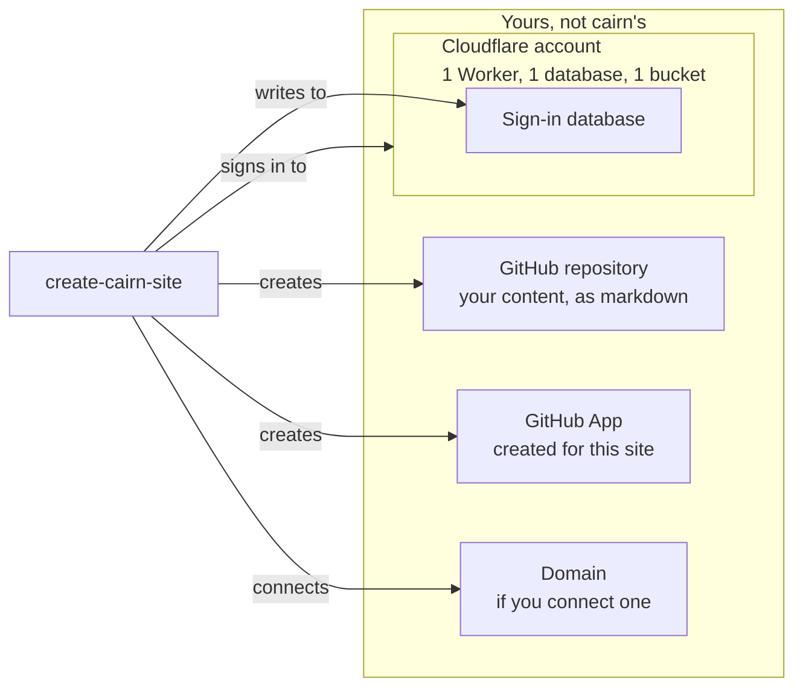

# Before you start

`create-cairn-site` builds a working cairn site from your own GitHub and Cloudflare accounts, and a person who runs it takes on a few things worth knowing first: what the setup creates, what it costs, and what stays yours if you stop. This page covers those three. It is for someone deciding whether to set a site up, or inheriting one that someone else set up. It leaves the setup itself to [Create your site](./create-your-site.md).

## What you end up owning

The setup command creates or connects five things, and every one of them belongs to you.

*The setup command creates or connects each of these once, then holds none of them.*

- **A private GitHub repository** holds your site's code and everything anyone writes. This is where your content lives on GitHub.
- **A GitHub App** commits on your writers' behalf, so nobody needs a GitHub account.
- **A Cloudflare account** runs one Worker, which is where your site runs. It also holds one database and one storage bucket for images.
- **A domain**, if you connect one.
- **A sign-in database**, which records who may sign in.

Nothing is rented from cairn. If you stopped using cairn tomorrow, your repository would still hold every word anyone wrote, in plain markdown that a text editor opens. Cloning that repository is enough to leave with everything.

## What it costs

Two things cost money, and a third is an admission requirement that costs nothing. The setup command prints the first two before it asks you anything.

1. **Cloudflare's Workers Paid plan, $5 a month.** A cairn site needs it from its first deploy. Cloudflare bills it once per account, so a second site on the same account adds nothing ([Workers pricing](https://developers.cloudflare.com/workers/platform/pricing/), as of 2026-08-11).
2. **A domain name, only if you connect your own.** The common endings run about $10 to $15 a year, paid to whichever registrar you use. Cloudflare sells domains at cost and shows the exact price before you pay ([Cloudflare Registrar](https://www.cloudflare.com/products/registrar/), as of 2026-08-11). A domain you already own costs nothing new.
3. **A Cloudflare API token, free, which you create yourself.** The setup command does not ask for one during a first run. [Own your domain](./own-your-domain.md) opens Cloudflare's "create token" page with the permissions already selected and asks you to paste the token back.

The plan and a year of domain renewal come to about $6 a month for a small site on its own domain. The database, the storage bucket, and the GitHub repository cost nothing at this size.

One item is unconfirmed. Connecting your domain issues a certificate for it, and Cloudflare does not say whether the plan includes that certificate or charges for it as an add-on. Your first bill shows which.

Read every row of the token page before you save it. Cloudflare can render a permission row as an empty control when something goes wrong on its end. The setup command accepts a token that is missing a permission and fails later, at the step that needed it.

## What a second writer needs

Everyone other than you signs in through a link sent to their email address. Sending that mail takes two things your site does not have on day one: a domain of your own, and sign-in email turned on for it through Cloudflare. A site that still lives only at its `workers.dev` address has no domain to send from.

Cloudflare includes email sending in Workers Paid up to a monthly allowance, and Cloudflare bills sends past it. A small site's sign-in mail stays well inside the allowance. Cloudflare's [Email Service pricing](https://developers.cloudflare.com/email-service/platform/pricing/) page carries the current numbers.

Until you add a second writer, you can skip both. Your site works the same either way, and you remain the only person who signs in. [Own your domain](./own-your-domain.md) connects the domain and turns on sign-in email together, and [Invite editors](./invite-editors.md) takes over from there.

## What needs a developer

Everything in the preceding sections you do yourself, without writing code. Three jobs need someone who can write and ship code:

- Rotating the GitHub App's private key is a terminal task. See [Rotate the GitHub App key](../extend/rotate-the-github-app-key.md).
- Updating the cairn engine to take a new release. See [Upgrade cairn](../extend/upgrade-cairn.md).
- Adding anything cairn does not ship, such as a custom admin screen or a second group of people who sign in. The [extend track](../extend/README.md) covers that, and it is the link to hand a developer.

[Is it working?](./is-it-working.md) routes several more conditions to a developer. Most of them appear only on a site that someone has customized or built by hand, and that page says which is which.

## Hand a site on, or leave with your content

Two accounts hold everything: GitHub and Cloudflare. To hand the site to a successor, add them as a collaborator on the repository in GitHub, and add them to your Cloudflare account the same way. Then add them as an editor on the site through [Invite editors](./invite-editors.md), so they can sign in once they have access to both.

Every entry is a markdown file in a git repository, and no database holds content that only cairn can read. Leaving takes one step: clone the repository.
