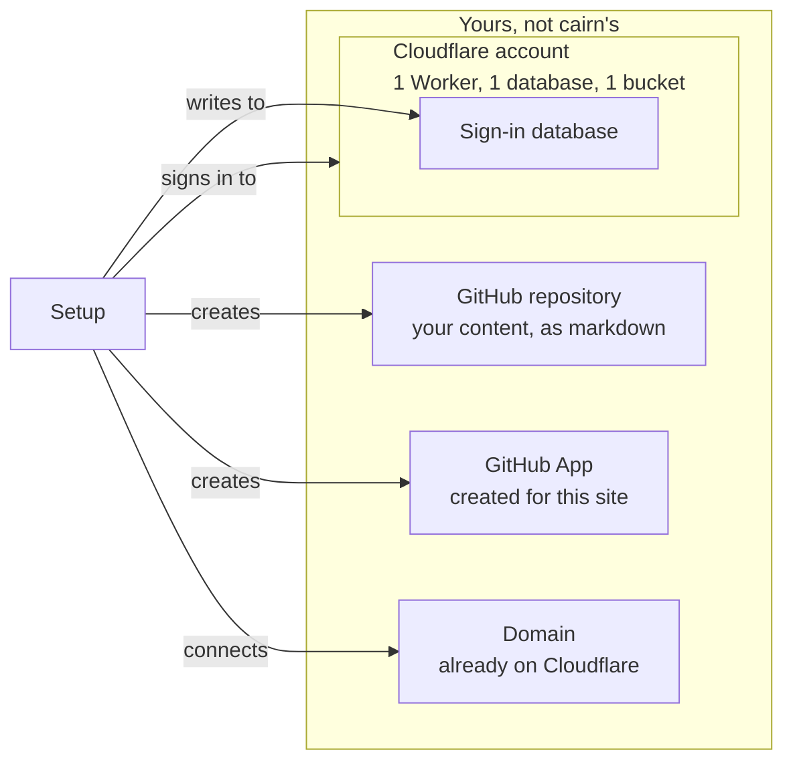

# Before you start

Setting up a cairn site takes accounts you own, a domain on Cloudflare, and one paid plan. This page is for someone deciding whether to set a site up, getting ready to run setup, or inheriting a site that someone else set up. It covers what setup creates, what you need ready on your computer and on each account, what it costs, what adding a second writer takes, which jobs need a developer, and how to hand the site to a successor. It leaves the setup itself to [Create your site](./create-your-site.md).

## What you end up owning

Setup creates or connects five things, and each belongs to you.

*Setup creates or connects each of these once, then holds none of them.*

- Your GitHub repository is private. It holds the site's code and everything anyone writes, which is where your content lives on GitHub.
- A GitHub App commits on your writers' behalf, so nobody needs a GitHub account.
- Your Cloudflare account runs one Worker, which is where your site runs. It also holds one storage bucket for images and one database.
- That one database is the sign-in database, and it records who may sign in.
- Your domain serves the site. Setup connects it, and you keep it.

Setup also leaves a working copy of the site in a folder on your computer, named for the repository.

Every entry is a markdown file in the repository, and no database holds content that only cairn can read. Cloning the repository takes every entry with you. Uploaded images live in the storage bucket, so leaving with everything also means copying the bucket's contents from your Cloudflare account.

## What you need on your computer

Setup runs on the computer where you use your browser, and it checks each item in this section before it creates anything. A check that fails names this section, creates nothing, and resumes at the same place when you run setup again.

- A browser on the same computer. Setup opens its approval pages there, so it stops when you run it over SSH or without a display. Run it in a terminal on the computer you browse with.
- [Git](https://git-scm.com/downloads).
- [Node.js](https://nodejs.org) 24 or later. Setup reads the version and reports the one it found when it is older.
- Port 49152 free. Setup serves its approval pages from `http://127.0.0.1:49152`, so a second setup running at the same time, or any other program using that port, stops it. Finish or stop the other one and run setup again.
- A keyring you can unlock: the macOS Keychain, the Windows Credential Manager, or the Linux Secret Service. Setup keeps its credentials there while it runs and deletes them when it finishes.
- An internet connection. Setup downloads the site template from npm.
- No folder named for your repository where you run setup, or an empty one. Setup writes the site into a folder in the directory where you start it, and it stops rather than write into a folder that holds files.

## What you need on GitHub

Setup needs a personal [GitHub account](https://github.com/signup). It creates the repository there, and it doesn't support a GitHub organization. If you're signed out when setup reaches GitHub, you sign in on GitHub's page in the setup tab.

## What you need on Cloudflare

Have each of these ready before you start. Setup checks the account and the domain right after you approve Cloudflare's first request, and it stops there when one is missing.

- A [Cloudflare account](https://dash.cloudflare.com/sign-up). Setup signs in to an account you already have and doesn't create one. When the account has none, setup says so and creates nothing.
- The Workers Paid plan, $5 a month, turned on from [your account's Workers plans page](https://dash.cloudflare.com/?to=/:account/workers/plans). A cairn site needs it from its first deploy. Setup can't read the plan from your account, so it finds a missing plan only when the first deploy fails. [What it costs](#what-it-costs) has the price.
- A domain that is active on Cloudflare. Setup has no `workers.dev` path, because sign-in links go out by email and Cloudflare sends email only from a domain on your account. You can [register a domain with Cloudflare](https://developers.cloudflare.com/registrar/get-started/register-domain/), or [add a domain you already own](https://developers.cloudflare.com/dns/zone-setups/full-setup/setup/). Adding one changes its nameservers, and Cloudflare can take hours to mark it active. Setup reports a domain that is still pending, creates nothing, and resumes when you run it again after the domain is active. [Own your domain](./own-your-domain.md) covers the existing records and the email that come with a domain you add.

## What it costs

Two things cost money.

- Cloudflare's Workers Paid plan costs $5 a month. A cairn site needs it from its first deploy. Cloudflare bills it once per account, so a second site on the same account adds nothing ([Workers pricing](https://developers.cloudflare.com/workers/platform/pricing/), as of 2026-08-11).
- A domain name costs about $10 to $15 a year for the common endings. You pay Cloudflare or your registrar. Cloudflare sells domains at cost and shows the exact price before you pay ([Cloudflare Registrar](https://www.cloudflare.com/products/registrar/), as of 2026-08-11). A domain you already own costs nothing new.

The plan and a year of domain renewal come to about $6 a month for a small site on its own domain. The database, the storage bucket, and the GitHub repository cost nothing at this size.

Each publish deploys the site through GitHub Actions. A private repository on GitHub's free plan gets about 2,000 Actions minutes a month, which covers roughly 650 deploys. The summary at the end of setup states this limit.

One item is unconfirmed. Connecting your domain issues a certificate for it, and Cloudflare doesn't say whether the plan includes that certificate or charges for it as an add-on. Your first bill shows which.

## What a second writer needs

Everyone other than you signs in through a link sent to their email address, and setup turns on the sending for you. It onboards your domain for Cloudflare's email sending and sends your own first sign-in link by email as well as through your browser, so you can see that the mail works.

Workers Paid includes 3,000 outbound emails a month, and Cloudflare charges $0.35 per 1,000 beyond that ([Email Service pricing](https://developers.cloudflare.com/email-service/platform/pricing/), as of 2026-10-31).

[Invite editors](./invite-editors.md) takes over from there. If your domain already carries mail for other services, read [Own your domain](./own-your-domain.md#turn-on-sign-in-email) before you run setup.

## What needs a developer

You do everything in the preceding sections yourself, without writing code. Rotating the App's private key is a terminal task you can also do yourself, and [Rotate the GitHub App key](./rotate-the-github-app-key.md) walks through it. Two jobs need a developer:

- Taking a new cairn release. The package's `MIGRATION-NOTES.md` carries the upgrade procedure and the steps a release adds, so hand a developer that file.
- Adding anything cairn doesn't ship, such as a custom admin screen or a second sign-in group. The [cairn repository](https://github.com/glw907/cairn-cms) is the link to hand a developer.

[Check that your site works](./is-it-working.md) routes several more conditions to a developer. Most of them appear only on a site that someone has customized or built by hand, and that page says which is which.

## Hand the site to a successor

Two accounts hold everything: GitHub and Cloudflare. To hand the site over, give the successor access in three places:

1. In GitHub, add them as a collaborator on the repository.
2. In Cloudflare, add them as a member of your account.
3. In the admin, add them as an owner. [Invite editors](./invite-editors.md) shows how.

## See also

- [Create your site](./create-your-site.md) runs the setup.
- [Own your domain](./own-your-domain.md) covers the domain's existing records and the sign-in email.
- [Check that your site works](./is-it-working.md) explains each readiness result.
- [Set up with an agent](./set-up-with-an-agent.md) is the same setup run through a coding agent.
