# Create your site

A cairn site runs on accounts you own: a GitHub account holds its content, and a Cloudflare account runs it. The setup command, `create-cairn-site`, creates the site, connects it to both, and signs you in as its owner. Because the accounts are yours, the command stops several times and asks you to approve something in your browser. This page walks one run from an empty terminal to a signed-in admin, and then shows how to sign in again.

The page is for someone who is comfortable pasting a command into a terminal and clicking through a dashboard, and who writes no code. [Before you start](./before-you-start.md) covers what the setup creates and what it costs. [Own your domain](./own-your-domain.md) covers the optional steps that follow, and [Recover a setup that stopped](./setup-recovery.md) covers a step that fails or stops partway.

## Prerequisites

Have the following ready before you run the command.

- A Mac or a Linux computer, or [Windows Subsystem for Linux](https://learn.microsoft.com/windows/wsl/install). Native Windows isn't supported, and neither are Git Bash or PowerShell. A run there gets partway and then fails with an unclear error.
- [Node.js](https://nodejs.org) 24 or later. The command checks your version before it asks anything.
- A [GitHub account](https://github.com/signup) and a [Cloudflare account](https://dash.cloudflare.com/sign-up). Both are free to open. The command signs in to accounts you already have and doesn't create either one.
- Cloudflare's Workers Paid plan, $5 a month, turned on before the deploy step. [Before you start](./before-you-start.md#what-it-costs) explains the charge.

## Run the setup command

The command asks five short questions, scaffolds the site on your computer, and then continues to GitHub and Cloudflare in the same run. Both of those stages ask before they act, so you can stop and finish later.

1. Open a terminal.
2. Run the command:

   ```
   npx create-cairn-site
   ```

3. Answer the prompts. Press Enter to accept a default or to leave an optional answer blank.

The excerpts on this page come from one real run, for a site named `cairn-docs-capture-2` under the GitHub account `glw907`. Your site's name, your account, and the addresses built from them appear in their place.

The command opens with what the site costs to run, the same facts as [Before you start](./before-you-start.md):

<!-- transcript: packages/create-cairn-site/test/fixtures/transcripts/01-create-cairn-site.txt -->
```
Before you start, the honest cost picture.

Cloudflare's Workers Paid plan costs $5 US per month, billed once per account, not once per site (as of 2026-08-11, https://developers.cloudflare.com/workers/platform/pricing/). That runs your site on Cloudflare's global network, from the day you deploy it.
```

The five prompts ask for the following:

- The site's name.
- An optional one-line description.
- An optional brand color.
- Whether your `robots.txt` should decline or invite AI training crawlers or state no preference. The default is no preference.
- The folder to create.

The command then prints `Your site is scaffolded` and instructions for running the site on your computer. You can ignore them, because the run continues to GitHub.

## Create the GitHub App and repository

The command creates a private GitHub repository for your content and a GitHub App that exists only for this site. The App commits to the repository for you and for your writers, so no writer needs a GitHub account. The command explains the step and asks before it starts:

<!-- transcript: packages/create-cairn-site/test/fixtures/transcripts/01-create-cairn-site.txt -->
```
Confirm the GitHub App and repository
This step creates a GitHub App named cairn-cairn-docs-capture-2 that only this site uses, a private repository named cairn-docs-capture-2, and needs two trips to your browser.
```

The App can write your site's content and manage the repository's settings, including deleting it. The command warns that GitHub doesn't allow an App's permissions to be reduced later, so that access lasts as long as the App does. The App also holds permission to write GitHub Actions workflow files, because your site carries a workflow that checks its own code on every push, and GitHub requires the permission to push it.

If you create the App under an organization, GitHub can require an organization owner to approve the install. The command then says so and stops cleanly. Run the same command again after an owner approves.

To create and install the App, do the following:

1. If you're signed out of GitHub, sign in.
2. Answer **Yes** at the prompt.
3. Choose the account, and accept the repository and App names.
4. In the browser page the command opens, click the button that creates the GitHub App.
5. In the second browser page, install the App on your account and choose **All repositories**.
6. Click **Install & Authorize**.
7. If GitHub asks you to approve once more to finish signing in, approve it.

The first page is a local address on your own computer that posts the App's settings to GitHub. The terminal prints it and waits:

<!-- transcript: packages/create-cairn-site/test/fixtures/transcripts/01-create-cairn-site.txt -->
```
Create your GitHub App
Your browser will open GitHub's "Create GitHub App" page for cairn-docs-capture-2; click the "Create the GitHub App" button there to create cairn-cairn-docs-capture-2.
Sign in to GitHub first if you are not already. A signed-out click lands on "We didn't find an App Manifest for your request"; if you see that page, sign in, then return to this browser tab and click the button again (it stays open).
Open this link if the browser did not open: http://127.0.0.1:36927
Waiting for the browser step to finish creating cairn-cairn-docs-capture-2... keep the browser window open.
If GitHub says the name "cairn-cairn-docs-capture-2" is already taken, press Ctrl+C and re-run with --app-name <a-new-name>.
```

Open the printed link if no page opened, and use that link rather than going to GitHub yourself. GitHub's own "create an App" form starts blank, and an App made there never reports back to the command.

The command creates the repository after the install page, so a narrower choice than **All repositories** has nothing to select yet. After the push finishes, you can narrow the installation to your repository in your GitHub settings. If you choose a narrower option first and GitHub doesn't add the new repository to it, the command reports that the installation doesn't include your repository. [Recover a setup that stopped](./setup-recovery.md#get-your-site-onto-github) shows the fix.

## Deploy to Cloudflare

When your repository exists, the command asks whether to install, build, and deploy the site now. Deploying puts the site live, so it answers visitors the moment anyone opens its address. Your Workers Paid plan must be on before you answer yes.

1. Answer **Yes** at the prompt.
2. Enter the email address you will sign in with.
3. Wait while the command installs the site's dependencies.
4. If you aren't signed in to Cloudflare, the command opens Cloudflare's sign-in. Sign in and approve wrangler's access.

Wrangler is Cloudflare's tool, and it does the deploying. The command then builds the site and deploys it to your Cloudflare account. This creates one Worker, which is where your site runs, one database for sign-ins, and one storage bucket for images. Your written content stays in the GitHub repository from the previous step, and only uploaded images go in the bucket.

The command next moves the App's private key off your computer and into the Worker's secret store. It keeps no copy, and Cloudflare doesn't let anyone read a secret back out.

## Sign in

The command writes your owner record into the new site's database and opens a sign-in page in your browser. This is the last browser step. Click **Sign in** on that page. You land in your site's admin, signed in as its owner.

<!-- transcript: packages/create-cairn-site/test/fixtures/transcripts/01-create-cairn-site.txt -->
```
Sign you in
Writing your sign-in row to the site's database.
[...]
A sign-in page just opened; click Sign in there. The link works for ten minutes; if it expires, re-run with --sign-in for a fresh one.
This site is set up end to end.
```

The link works for ten minutes. If you miss it, [sign in again](#sign-in-again).

The command then asks whether to connect a domain you own. Answering no changes nothing, and [Own your domain](./own-your-domain.md) covers connecting one now or later.

```mermaid
flowchart LR
  accTitle: Diagram of the setup journey from scaffold to sign-in, with browser steps flagged
  accDescr: The command scaffolds your site locally, then creates the GitHub App, installs it on your account, creates the repository and pushes the site, installs dependencies, signs in to Cloudflare if you are not signed in already, builds and deploys, and finally opens the sign-in page. Browser steps mark the App creation, the App install, the Cloudflare sign-in, and the final sign-in page.

  scaffold["Scaffold<br/>locally"]

  subgraph github["GitHub"]
    createApp["Browser:<br/>create GitHub App"]
    installApp["Browser:<br/>install App on account"]
    pushRepo["Create repository<br/>and push"]
    createApp --> installApp --> pushRepo
  end

  subgraph cloudflare["Cloudflare"]
    deps["Install<br/>dependencies"]
    cfSignin["Browser:<br/>sign in, if not already"]
    cfDeploy["Build<br/>and deploy"]
    deps --> cfSignin --> cfDeploy
  end

  signin["Browser:<br/>sign-in page opens"]

  scaffold --> createApp
  pushRepo --> deps
  cfDeploy --> signin
```



*Three browser steps mark this path, or four if you aren't already signed in to Cloudflare.*

## Verify the finished site

The command finishes by printing where everything is:

<!-- leak-ok-begin: C1 -- the recorded run's GitHub owner name is a knowingly published identifier (fixtures README, Identifiers) -->
<!-- transcript: packages/create-cairn-site/test/fixtures/transcripts/01-create-cairn-site.txt -->
```
Your site is live on GitHub: https://github.com/glw907/cairn-docs-capture-2
The App that publishes for you: https://github.com/apps/cairn-cairn-docs-capture-2

Your site is live at: https://cairn-docs-capture-2.glw907.workers.dev
Sign in at: https://cairn-docs-capture-2.glw907.workers.dev/admin

What exists now: one Worker, one database, one storage bucket, and the GitHub App's private key, stored as a Worker secret.
```
<!-- leak-ok-end -->

Check the result in this order:

1. Open the `Your site is live at` address. The starter site loads.
2. Open the `Sign in at` address. You land in the admin signed in, from the link the command opened.
3. Install the `cairn` CLI from the [release page](https://github.com/glw907/cairn-cms/releases).
4. Run `cairn doctor` from the site's folder. [Check that your site works](./is-it-working.md) explains each result.

The site stays at its `workers.dev` address even after you connect a domain. Before you add a second writer, read [what a second writer needs](./before-you-start.md#what-a-second-writer-needs).

## Sign in again

The sign-in link the command opens works for ten minutes. If you close the tab, wait too long, or the link stops working, you can get a fresh one from the computer that created the site.

1. Open a terminal on that computer.
2. Run the command with the folder you created:

   ```
   npx create-cairn-site --dir <the-folder-you-created> --sign-in
   ```

The command writes a fresh link straight into your site's database and opens it, with no email involved. It works once the site is live. While a domain connection is half done, the same command resumes the domain steps first. Once you're signed in, that session lasts 30 days, so you rarely need this.

If a step before this one failed and the site never went live, see [Recover a setup that stopped](./setup-recovery.md).

## See also

- [Before you start](./before-you-start.md) covers the cost and what stays yours.
- [Own your domain](./own-your-domain.md) moves the site onto a domain and turns on sign-in email.
- [Invite editors](./invite-editors.md) adds the people who write on the site.
- [Troubleshoot a live site](./troubleshooting.md) covers a live site that misbehaves.
