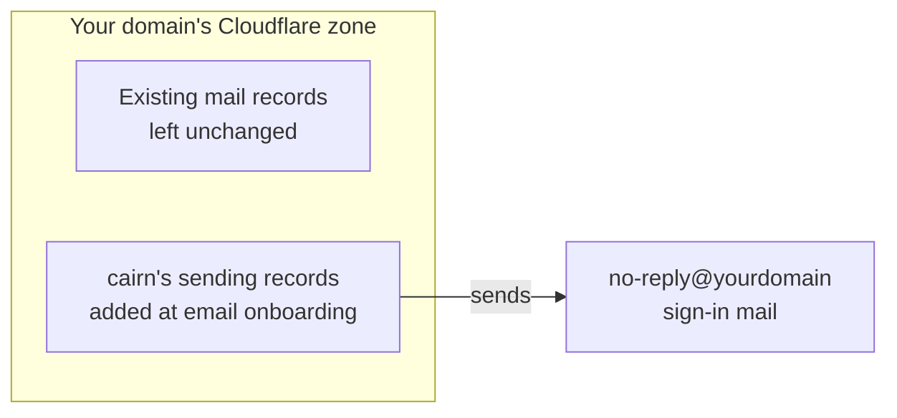

# Own your domain

A cairn site serves from a domain that is active on Cloudflare, and setup connects that domain for you. This page is for the person who is about to run setup, or already has, and wants to use a domain registered somewhere else. It gets the domain onto Cloudflare and states what the sign-in email does to the domain's mail. It leaves the run itself to [Create your site](./create-your-site.md), and a part that stalls to [Recover a setup that stopped](./setup-recovery.md).

## Prerequisites

- A domain that is already registered, at any registrar. This page connects a domain you own and doesn't sell you one. To buy one, [register it with Cloudflare](https://developers.cloudflare.com/registrar/get-started/register-domain/) and skip to [Choose the site's address](#choose-the-sites-address), because a domain registered there is active already.
- Access to the domain's DNS settings and its nameservers at your registrar. If you don't control the domain's DNS yourself, stop here and talk to whoever does: an agency, a previous developer, or an IT contact. Guessing or forcing past this risks your organization's existing mail.
- A domain that isn't already active under someone else's Cloudflare account. Such a domain doesn't appear in yours, and setup reports that your account has no domains. The fix is for that person to remove it from their account.

## Add your domain to Cloudflare

Cloudflare calls the settings and records it holds for your domain a zone. A nameserver is the server that answers questions about your domain. Your domain keeps using its old nameservers until you change them, and the change is the step that takes time. Setup checks that a domain on your account is active. When none is yet, it stops with a note that the domain is still being added, creates nothing, and resumes when you run it again.

1. In the Cloudflare dashboard, add your domain, following [Cloudflare's guide to adding a domain](https://developers.cloudflare.com/dns/zone-setups/full-setup/setup/). Adding it creates the zone and gives you a pair of nameservers.
2. Review the DNS records Cloudflare lists for the zone. [Carry over existing DNS records](#carry-over-existing-dns-records) explains why.
3. If a record from your registrar is missing, add it in Cloudflare's DNS settings before you change nameservers.
4. At your registrar, the company where you bought the domain, replace the domain's nameservers with the pair Cloudflare gave you.
5. Wait until Cloudflare shows the domain as active.

The change spreads across the internet gradually, which is called propagation, and it can take hours. If you run setup before then, it stops at the first Cloudflare check, creates nothing, and resumes when you run `cairn new` again.

### Carry over existing DNS records

DNS records are the entries that tell the internet where your domain's web traffic and mail go. Your domain probably carries records that have nothing to do with cairn, and mail records are the most common. Setup never edits or deletes a record your zone already holds. It refuses an address that already has an A, AAAA, or CNAME record or a Worker, and it adds only the records the site needs. Mail records such as MX and TXT don't count, so a domain with live mail can still host the site on its bare address.

Cloudflare, not setup, brings records into a new zone when you add a domain, and its scan can miss a record. Compare the list with what you know before you switch nameservers. Mail that depends on a missing record stops working when the switch takes effect. An owner with live mail is the most exposed here, so read [Turn on sign-in email](#turn-on-sign-in-email) as well.

### You know it worked when

Cloudflare shows the domain as active, and setup's first Cloudflare check passes with no stop about a pending domain. A domain you registered through Cloudflare is active at once, with nothing to copy.

## Choose the site's address

Setup serves the site at your bare domain and its `www` form, such as `example.com` and `www.example.com`. On the summary, you can change this to a subdomain of the domain, such as `blog.example.com`, which gets no `www`. Setup checks the address in the opening and again when you change it, and it refuses one that already points somewhere else. If the account has several active domains, setup asks which to use.

When the site's HTTPS certificate is ready, setup confirms that your address answers over HTTPS. This can take up to 15 minutes. If it takes longer, setup stops with the work kept, and running it again resumes at that step.

## Turn on sign-in email

Setup turns on sign-in email during the run. It onboards your site's address for Cloudflare's email sending, and the admin sends each sign-in link from `no-reply@` that address. Everyone other than you signs in through such a link, so [Invite editors](./invite-editors.md) depends on it.

*One zone holds both groups of records. Setup leaves the existing mail records unchanged. When the domain has no DMARC policy yet, Cloudflare adds one for the whole domain, so it also governs mail your organization sends.*

Two different things share this one domain, and they are easy to conflate:

- The address your site sends sign-in mail from is `no-reply@yourdomain`. It uses Cloudflare's sending service.
- Your organization's existing mail on the domain stays as it is and has nothing to do with the site's sign-in mail.

A DMARC record is a mail-policy entry at `_dmarc.yourdomain`. When your domain has none, Cloudflare's onboarding adds one with the policy `p=reject`, and when it already has one, onboarding keeps it unchanged. A `p=reject` policy asks receivers to reject mail that claims to come from your domain without authenticating, and it covers every sender on the domain, not only cairn. Otherwise a receiver rejects mail from any service that doesn't authenticate. Before you run setup:

1. List the services that already send as your domain, such as a newsletter tool, a ticketing system, or a mailing list.
2. Follow each one's instructions for authenticating against your domain's mail records.
3. Do the same for any service you add afterward.

A new domain has no sending history, so mail providers can delay mail from it. If someone's first sign-in link doesn't arrive at once, this delay is the usual reason. It isn't a sign that anything is broken.

The running site reads none of your SPF, DKIM, or DMARC records, so a broken record never shows up as a site error. Only `cairn doctor` looks at them. It checks that a DMARC record with a real policy exists, that an SPF record names Cloudflare's mail servers, and that a DKIM record answers under one of a short list of common selector names. A DKIM record under any other name goes unseen, so a missing result there doesn't prove the record is absent.

### You know it worked when

Setup emails your first sign-in link to the address you gave it, and the done screen says so. [Invite editors](./invite-editors.md) covers getting other people signed in.

## See also

- [Before you start](./before-you-start.md) covers the cost of a domain and of sign-in email.
- [Invite editors](./invite-editors.md) adds the people who sign in with the new email.
- [Recover a setup that stopped](./setup-recovery.md) covers a domain step that stalls.
