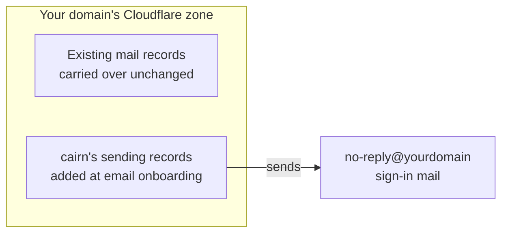

# Own your domain

A new site answers at a `workers.dev` address that Cloudflare assigns. This page moves the site onto a domain you own, turns on the sign-in email that lets anyone besides you sign in, and optionally connects the site's repository to Cloudflare so that every push deploys itself. You can stop after any part. Sign-in email needs the domain part first, and Workers Builds needs neither.

The page is for the person who ran the setup command, `create-cairn-site`, and now wants a domain or a second writer. If you only want pushes to redeploy the site, skip to [Connect to Workers Builds](#connect-to-workers-builds). A part that stalls is covered by [Recover a setup that stopped](./setup-recovery.md).

The first two parts share one Cloudflare API token. The Workers Builds part needs a second, wider token. Run the setup command from the computer that created the site, and run it again whenever you want the next part. Each run picks up where the last one stopped.

```
npx create-cairn-site --dir <your-site-directory>
```

## Prerequisites

- A site that has finished [Create your site](./create-your-site.md).
- A domain that is already registered, at any registrar. This page connects a domain you own and doesn't sell you one.
- For sign-in email, Cloudflare's Workers Paid plan, which the deploy step already required.

## Connect your domain

Creating the Cloudflare zone and connecting the domain both run on the free plan. A zone is Cloudflare's name for the settings and records it holds for your domain. Whether the domain's certificate adds a charge is unconfirmed, and [What it costs](./before-you-start.md#what-it-costs) explains.

1. Run the setup command with your site's directory.
2. Answer **Yes** to `Connect a domain you own to this site now?`, then enter your domain.
3. In the browser page the command opens, read every row of the permissions that Cloudflare selected: Zone, DNS, Workers Scripts, SSL and Certificates, and email sending.
4. Create the API token.
5. Paste the token into the terminal.
6. Review the DNS records the command lists, and confirm the copy. [Carry over existing DNS records](#carry-over-existing-dns-records) explains what the list covers.
7. Switch your domain's nameservers, as [Switch your domain's nameservers](#switch-your-domains-nameservers) describes.

Cloudflare can render a permission row as an empty control when something goes wrong on its end. A token missing a permission still passes this step and fails later, at the step that needed it.

### Switch your domain's nameservers

Cloudflare creates the zone and gives you a pair of nameservers. A nameserver is the server that answers questions about your domain, and your domain keeps using its old ones until you change them.

1. Copy the pair of nameservers that the command prints.
2. At your registrar, the company where you bought the domain, replace the domain's nameservers with that pair.
3. Run the setup command again to check whether the switch has taken effect.

The change spreads across the internet gradually, which is called propagation, and it can take anywhere from a few minutes to 48 hours. The site keeps answering at its `workers.dev` address in the meantime.

### Carry over existing DNS records

DNS records are the entries that tell the internet where your domain's web traffic and mail go. Your domain probably carries records that have nothing to do with cairn, and mail records are the most common. Before the switch, the command reads the records your domain has today and shows them to you. It copies them into the new Cloudflare zone only after you confirm. The list comes from a fixed set of lookups, so it can miss a record the lookups never asked about. Compare it with what you know.



*After the switch, one zone holds both groups of records, and the existing mail records carry over unchanged. The DMARC policy that sign-in email adds applies to the whole domain, so it also governs mail your organization sends.*

Two different things share this one domain, and they are easy to conflate:

- The address your site sends sign-in mail from is `no-reply@yourdomain`. It uses Cloudflare's sending service, and it exists only once you turn on sign-in email.
- Your organization's existing mail on the domain carries over unchanged and has nothing to do with the site's sign-in mail.

If you don't control the domain's DNS yourself, stop here and talk to whoever does: an agency, a previous developer, or an IT contact. Guessing or forcing past this step risks your organization's existing mail. A domain already active under someone else's Cloudflare account can't be connected from yours. The command says so, and the one fix is for that person to remove the domain from their account.

If your domain's nameservers already point at Cloudflare, for example a domain you registered through Cloudflare, the zone arrives active and there is nothing to copy.

### You know it worked when

The command confirms that your domain answers over HTTPS, switches the site's address to the domain, and redeploys once. The site then answers at both `https://yourdomain` and its original `workers.dev` address. Sign in at `https://yourdomain/admin`.

## Turn on sign-in email

Sign-in email is what lets anyone other than you sign in, because everyone else gets in through a link sent to their address. You keep signing in as the owner through [`--sign-in`](./create-your-site.md#sign-in-again) either way.

1. Finish [Connect your domain](#connect-your-domain), so the domain is live.
2. Answer **Yes** to `Turn on email sign-in for your domain now?`
3. Wait while the command onboards the domain for sending and sends a test message to your sign-in address.

The command asks in the same run once the domain is live. If the run stopped to wait for the nameserver switch, run it again.

Your Workers Paid plan was confirmed at the deploy step, so this step doesn't ask about it again. If you answer no, nothing changes: the site keeps serving, and you keep signing in as the owner.

A new domain has no sending history, so mail providers can take a while to trust it. If someone's first sign-in link doesn't arrive at once, this delay is the usual reason. It isn't a sign that anything is broken.

Onboarding also writes a DMARC record, a mail-policy entry, at `_dmarc.yourdomain` with the policy `p=reject`. The policy asks receivers to reject mail that claims to come from your domain without authenticating. The record covers every sender on the domain, not only cairn, and it stays even if you turn sending off later. Before you turn on sign-in email, list the services that already send as your domain, such as a newsletter tool, a ticketing system, or a mailing list. Follow each one's instructions for authenticating against your domain's mail records, and do the same for any you add afterward. Otherwise a receiver rejects its mail.

### You know it worked when

The command reports that Cloudflare accepted a test message sent from your site to your sign-in address. [Invite editors](./invite-editors.md) covers getting other people signed in.

## Connect to Workers Builds

Workers Builds is Cloudflare's service for building and deploying from a repository. Once it's connected, every push to the repository's default branch deploys the site without your computer or the setup command. The step is optional, separate from the domain parts, and available as soon as the site is live.

Workers Builds needs a second token that reaches every Cloudflare account and zone you own. It has the same five permissions as the first token, plus three that Workers Builds needs. Cloudflare keeps it as the build token and hands it to every build, so anyone who can push to your default branch can read it. Revoking or rolling the token later can break your automatic deploys: the next push builds and then fails. If you rotate tokens on a schedule, update this one too.

1. Run the setup command with the connect flag:

   ```
   npx create-cairn-site --dir <your-site-directory> --connect
   ```

2. Create a fresh Cloudflare API token in the browser page the command opens.
3. Paste the token into the terminal.
4. If the command asks, authorize Cloudflare's Workers and Pages GitHub App on your account.
5. Click the sign-in link the command opens later in the run.

If the Workers and Pages GitHub App isn't authorized yet, the run stops after the token paste and tells you where to authorize it. Run the command with `--connect` again afterward. It continues without asking for a fresh token.

Workers Builds is free at this scale. [Workers pricing](https://developers.cloudflare.com/workers/platform/pricing/) has the current limits.

### You know it worked when

The command watches your first Workers Builds deploy through to the end and confirms that the site answers. From then on, every commit to the default branch deploys itself.

A build deploys code and doesn't apply database migrations. A cairn update that ships a migration still needs a developer to run it. The package's `MIGRATION-NOTES.md` says which versions do.

## See also

- [Before you start](./before-you-start.md) covers the cost of a domain and of sign-in email.
- [Invite editors](./invite-editors.md) adds the people who sign in with the new email.
- [Recover a setup that stopped](./setup-recovery.md) covers a domain step that stalls.
