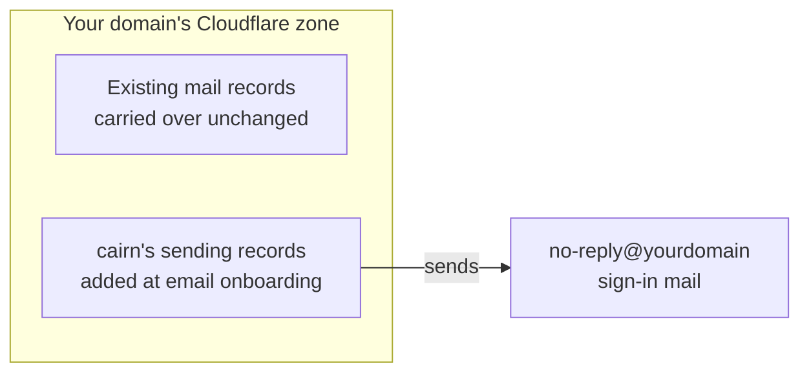

# Own your domain

A new site answers at a `workers.dev` address that Cloudflare assigns. This page moves the site onto a domain you own, turns on the sign-in email that lets anyone besides you sign in, and optionally connects the site's repository to Cloudflare so that every push deploys itself. Each of the three parts is separate, and you can stop after any of them.

The page is for the person who ran the setup command and now wants a real address or a second writer. If you only want pushes to redeploy the site and have no use for a domain, skip to [Connect to Workers Builds](#connect-to-workers-builds), which needs nothing from the first two parts. A domain half-connected or a step that stalls is covered by [Setup recovery](./setup-recovery.md).

The first two parts share one Cloudflare API token and run from the same command. The Workers Builds part needs a second, wider token. Run the command from the computer that created the site, and run it again whenever you want the next part. Each run picks up wherever the last one stopped.

```
npx create-cairn-site --dir <your-site-directory>
```

## Prerequisites

- A site that has finished [Create your site](./create-your-site.md).
- A domain that is already registered, at any registrar. This page connects a domain you own and doesn't sell you one.
- For sign-in email, Cloudflare's Workers Paid plan, which the deploy step already required.

## Connect your domain

Connecting a domain costs nothing on its own. Creating the Cloudflare zone, which is Cloudflare's name for the settings and records it holds for your domain, and connecting the domain both run on the free plan.

1. Run the setup command with your site's directory.
2. Answer **Yes** to `Connect a domain you own to this site now?`, then enter your domain.
3. In the browser page the command opens, create the API token with the permissions already selected, then paste the token back into the terminal.
4. Switch your domain's nameservers, as the next section describes.

The permissions are Zone, DNS, Workers Scripts, SSL and Certificates, and email sending. Read every row before you save the token. Cloudflare can render a row as an empty control when something goes wrong, and a token missing a permission still passes here and fails later, at the step that needed it.

### Switch your domain's nameservers

Cloudflare creates the zone and gives you a pair of nameservers. Your domain keeps pointing at its old nameservers until you go to your registrar, the company where you bought the domain, and change them to the new pair. The change spreads across the internet gradually. That spread is called propagation, and it can take anywhere from a few minutes to 48 hours.

Nothing breaks while you wait. The site keeps answering at its `workers.dev` address, and running the command again checks whether the switch has taken effect.

### If this domain already has DNS records

DNS records are the entries that tell the internet where your domain's web traffic and mail go. Your domain probably carries records that have nothing to do with cairn, and mail records are the most common. Before the switch, the command reads the records your domain has today and shows them to you. It copies them into the new Cloudflare zone only after you confirm. The list comes from a fixed set of lookups, so it can miss a record the lookups never asked about. Compare it with what you know.



*After the switch, one zone holds both groups of records. They stay separate, and nothing cairn adds touches the mail your organization already sends.*

Two different things share this one domain, and they are easy to conflate:

- The address your site sends sign-in mail from is `no-reply@yourdomain`. It uses Cloudflare's sending service, and it exists only once you turn on sign-in email.
- Your organization's existing mail on the domain carries over unchanged and has nothing to do with the site's sign-in mail.

If you don't control the domain's DNS yourself, stop here and talk to whoever does: an agency, a previous developer, or an IT contact. Guessing or forcing past this step risks your organization's existing mail. A domain already active under someone else's Cloudflare account can't be connected from yours. The command says so, and the one fix is for that person to remove the domain from their account.

If your domain's nameservers already point at Cloudflare, for example a domain you registered through Cloudflare, the zone arrives active and there is nothing to copy.

### You know it worked when

The command confirms that your domain answers over HTTPS, switches the site's own address to the domain, and redeploys once. The site then answers at both `https://yourdomain` and its original `workers.dev` address. Sign in at `https://yourdomain/admin`.

## Turn on sign-in email

Sign-in email is what lets anyone other than you sign in, because everyone else gets in through a link sent to their address. You keep signing in as the owner through [`--sign-in`](./create-your-site.md#sign-in-again) either way. The command asks once, and either answer is fine.

1. Run the command again after your domain is live.
2. Answer **Yes** to `Turn on email sign-in for your domain now?`
3. Wait while the command onboards the domain for sending and sends a real test message to your sign-in address.

Your Workers Paid plan was confirmed at the deploy step, so this step doesn't ask about it again. If you answer no, nothing changes: the site keeps serving and you keep signing in as the owner. The next run offers sign-in email again.

A new domain has no sending history, so mail providers can take a while to trust it. If someone's first sign-in link doesn't arrive at once, this warm-up is the usual reason. It isn't a sign that anything is broken.

Onboarding also writes a DMARC record, a mail-policy entry, at `_dmarc.yourdomain` with the policy `p=reject`. The policy asks receivers to reject mail that claims to come from your domain without authenticating. The record stays even if you turn sending off later. If you add a newsletter tool or mailing list to the domain afterward, follow that tool's own instructions for adding itself to your domain's mail records before you send through it. Otherwise its mail is rejected.

### You know it worked when

Cloudflare accepts a real test message sent from your site to your sign-in address. [Invite editors](./invite-editors.md) covers getting other people signed in.

## Connect to Workers Builds

Workers Builds is Cloudflare's service for building and deploying from a repository. Once it's connected, every push to the repository's default branch deploys the site with no laptop and no setup command. The step is optional and separate from the domain parts, and it works as soon as the site is live.

1. Run the command with the connect flag:

   ```
   npx create-cairn-site --dir <your-site-directory> --connect
   ```

2. Authorize Cloudflare's Workers and Pages GitHub App on your account, if you haven't for an earlier site.
3. Create a fresh Cloudflare API token and paste it back.
4. Click the sign-in link the command opens later in the run.

The token is a second, separate one: the same five permissions as the domain half, plus three that Workers Builds needs. Cloudflare keeps it as the build token and hands it to every build. It reaches every Cloudflare account and zone you own, so treat anyone who can push to your default branch as able to read it. Revoking or rolling the token later breaks your automatic deploys with no warning, because the next push still builds and then fails. If you rotate tokens on a schedule, update this one too.

Workers Builds is free at this scale. The free tier covers 3,000 build minutes a month and one build at a time ([Workers pricing](https://developers.cloudflare.com/workers/platform/pricing/), as of 2026-08-12).

If the Workers and Pages GitHub App isn't authorized yet, the run stops first and tells you where to authorize it. Run the command with `--connect` again afterward. It continues without asking for a fresh token.

### You know it worked when

The command watches your first Workers Builds deploy through to the end and confirms that the site answers there. From then on, every commit to the default branch deploys itself.

A build deploys code and doesn't apply database migrations. A cairn update that ships a migration still needs a developer to run it, as [Upgrade cairn](../extend/upgrade-cairn.md) describes.
