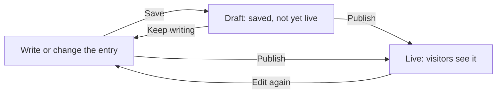

# Publish an entry and review its history

This page shows you how to move an entry between a private draft and your live site, and how to bring back an earlier version. It covers the header on the editing screen, saving, publishing, the three statuses, discarding changes, deleting, publishing several entries together, and the **Recent versions** list.

You need an entry with some writing in it, which [Write in the editor](write-in-the-editor.md) covers. This page doesn't cover what to do when a save or a publish fails. [When something goes wrong](when-something-goes-wrong.md) covers that.

## The header

The header at the top of the editing screen holds the controls for an entry's life: its status, whether it has unsaved changes, and the buttons that save and publish it.

```repro
story: publish/header-band
width: desktop
alt: Reproduction of the editing screen's header on a wide screen, with the More actions menu open beside the Publish and Save buttons.
caption: This entry is published and has no new edits, so Publish is dimmed and its tooltip reads Nothing new to publish. The menu lists History and Delete. Discard changes appears only when the entry has a saved draft.
```

On a phone, the header shrinks to a back arrow, the title, and one status chip. The **Save** and **Publish** buttons move to a bar at the bottom of the screen, and **Details** moves into the **More actions** menu.

```repro
story: publish/header-band
width: narrow
alt: Reproduction of the editing screen's header on a phone, with a back arrow, the title, a status chip, and the open More actions menu.
caption: A small dot beside the status chip appears when the entry has unsaved changes. The chip folds in the Hidden marker, so one chip carries the whole state.
```

The following table describes the header's parts on a wide screen.

| Part | What it shows or does |
|---|---|
| Status chip | Shows **New**, **Edited**, or **Published**. A second chip reads **Hidden** when you've set the entry to stay off lists and feeds. |
| Save indicator | Reads **Unsaved changes** while you have edits that aren't saved, and **Saved** after a save. |
| **Details** | Opens the panel of settings for the entry. |
| **More actions** | Opens a menu with **History**, **Discard changes**, and **Delete**. |
| **Publish** | Makes the entry live. |
| **Save** | Keeps your edits as a draft. |

## The three statuses

Every entry has one status, and the status tells you what visitors see.

| Status | What it means |
|---|---|
| **New** | The entry has never been published. Visitors can't see it. |
| **Edited** | The entry is live, and you or another editor saved changes that aren't live yet. Visitors still see the published version. |
| **Published** | The live version matches what the editor holds. The entry has no saved changes waiting. |

On a list, the **Pending edits** filter shows every entry marked **New** or **Edited**.

## Save a draft

**Save** keeps your edits as a draft that visitors can't see. Your site keeps showing the published version, if there is one, until you publish. The shortcut is Ctrl+S.

After you save, the editor shows **Saved. Your site keeps showing the published version until you publish.** and the save indicator reads **Saved**. **Save** is dimmed until you change something. A new entry is the exception, because you can save it as it opens.

If you leave the screen with unsaved changes, your browser asks **You have unsaved changes. Leave anyway?** Stay on the screen if you want to save first.

## How saving and publishing fit together

You can save as often as you like. Each save updates the draft, and nothing reaches the live site until you publish. A live entry that you edit again goes back around the same loop.



*Save and Publish are separate steps. A saved draft stays out of sight until you publish, and editing a live entry starts a new draft while the live version stays on your site.*

## Publish an entry

**Publish** makes the entry live. It saves your current edits first, so you don't need to select **Save** beforehand. The shortcut is Ctrl+Shift+S.

To publish an entry, follow these steps:

1. Open the entry and finish your edits.
2. In the header, select **Publish**.
3. Read the message under the header. It confirms that the entry published and adds that the live site is updating.

Your site may add links beside the message. **Publish** stays dimmed when there's nothing new to publish, which means no unsaved edits and no saved draft. A **Hidden** entry still publishes, but it stays off your site's lists and feeds.

If a publish doesn't finish, the editor keeps your edits and shows **Your edits are saved. Publish again.**, so you can select **Publish** a second time.

## Publish several entries at once

On screens outside an open entry, such as a list, the **Publish site** button publishes every entry that has a saved draft in one step. The button shows how many entries are waiting, for example **Publish site (2)**. It doesn't appear while you have an entry open, and it doesn't appear when no entries are waiting.

```repro
story: publish/pending-list
alt: Reproduction of the Publish the whole site confirmation, listing the waiting entries under their content type with Cancel and Publish site buttons.
caption: Two entries are waiting, so the button behind the window reads Publish site (2). The window names each entry by its address under its content type.
```

To publish everything that's waiting, follow these steps:

1. On a list screen, select **Publish site**.
2. In the **Publish the whole site?** window, read the list. It includes every waiting entry you have access to, whoever saved it.
3. Select **Publish site**. To back out, select **Cancel**.

The list then shows a message that reads **Published** followed by the number of entries.

## Discard changes

**Discard changes** throws away a saved draft. It appears in the **More actions** menu only when the entry has one. Select it, and the **Discard the unpublished changes?** window opens.

The window tells you what happens. For a live entry, discarding restores the live version, and the window warns that you can't recover the changes. For an entry that has never been published, discarding deletes the entry, and you can't recover anything. Select **Discard** to go ahead, or **Cancel** to keep the draft. After a discard on a live entry, the editor shows **Changes discarded.**

## Delete an entry

To delete an entry, follow these steps:

1. Open the entry, and then select **More actions**.
2. Select **Delete**. A window opens with the entry's type in the title, for example **Delete this post?**.
3. Read the warning that you can't undo the deletion and that any unpublished edits go with it.
4. Select the delete button, which repeats the title, for example **Delete this post**.

If other entries link to the one you're deleting, the window blocks the delete instead. It names how many entries link to it, lists them, and asks you to remove or repoint those links first. A fragment that other entries include gets the same block.

On a list, the trash button beside an entry deletes it at once, with no confirmation window, unless other entries link to it. To get the confirmation, delete from the entry's editing screen.

## Review and restore earlier versions

Each publish creates a version of the entry, and the history lists those versions so you can bring an earlier one back.

The **History** item is in the **More actions** menu on the editing screen. It appears only for an entry that you've published or saved.

```repro
story: publish/history-list
alt: Reproduction of the Recent versions list, with a Draft row on top followed by published versions that each carry a Revert button.
caption: The Draft row names who saved the draft and when, and it has no Revert button because a draft isn't a published version. The newest published version carries the Current chip.
```

The following table describes the columns in the list.

| Column | What it shows |
|---|---|
| **Status** | **Draft** on the saved-draft row, and **Current** on the newest published version. |
| **Editor** | The person who saved the draft or published the version. |
| **Date** | When the draft was last saved or the version was published. On a phone, the date sits under the editor's name. |

The list shows up to the 25 most recent published versions. When more exist, the page says **Showing the most recent 25 versions.** The list also reaches back only to the last time the entry's address changed. If you used **Change URL** on the entry, versions published before that change don't appear.

To bring back an earlier version, follow these steps:

1. In the **Recent versions** list, find the version you want.
2. In its row, select **Revert**.
3. Review the text on the editing screen. The editor has saved the old version as a draft, and your site still shows the current version.
4. Select **Publish** to make the old version live, or select **Discard changes** to drop it.

**Revert** never changes the live site by itself. If someone else already has a saved draft of the entry, the editor refuses and names that person and when they last saved. That draft has to be published or discarded before a revert can start.

## Where to go next

If a save, a publish, or a revert shows an error, see [When something goes wrong](when-something-goes-wrong.md). To keep writing, return to [Write in the editor](write-in-the-editor.md).
