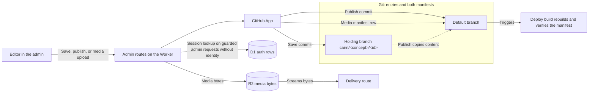

# Architecture

cairn is a library that a site installs as a dependency and runs inside its own Cloudflare Worker, with no CMS server of its own. The engine ships as the npm package `@glw907/cairn-cms`. A site's admin and public pages are route files in its SvelteKit app, and their load functions and form actions come from the engine's route factories. The app builds into that one Worker with `@sveltejs/adapter-cloudflare`.

Content lives as markdown in the site's GitHub repository. A publish is a commit through the site's GitHub App, and the site's existing deploy picks it up. Beyond the Worker, the site uses two Cloudflare stores: a D1 database holds the sign-in rows, and an R2 bucket holds media bytes.

Three properties of the engine decide which code a site writes and which contracts it relies on. One adapter declaration drives the engine. A site extends the engine through seams rather than by forking it. Each export carries a stability tier that states what it promises across versions.

An evaluator reads the page end to end. Some readers inherit a site that `create-cairn-site` set up, which created the site's GitHub App, repository, and Cloudflare bindings and deployed it in one run. Such a developer uses the page to map the site's files onto the engine's entry points, seams, and stores, and [Scaffolded site files](scaffolded-site-files.md) covers those files one by one. A developer partway through a task, such as adding a custom admin screen or replacing magic links, follows a link here to place one seam among the rest.

The page assumes a working knowledge of SvelteKit routing, load functions, form actions, and server hooks, of Cloudflare Worker bindings, and of git branches and GitHub Apps at a user's level. It covers the following subjects, in this order:

- The adapter and the runtime it composes.
- The files that reach the engine, the subpaths they import, and the rules that place each export.
- The seams through which a site supplies code or data.
- The path an edit takes from a save to the deploy, and how the admin reads content back.
- Where each kind of state lives.
- The platforms the engine builds on, and the contract a replacement content store keeps.
- What each stability tier promises across versions.

The page leaves the following subjects to other pages:

- The security properties of each piece, in [Security model](security-model.md).
- Declaring the adapter field by field, in [Define an adapter and schema](define-an-adapter-and-schema.md).
- Concepts and fieldsets in depth, in [Content model](content-model.md).
- Each export's signature, in [the reference index](../reference/README.md).
- The upgrade procedure, in [Upgrade cairn](upgrade-cairn.md).
- The media store's settings, in [Configure media](configure-media.md).

## The adapter

A cairn site declares one adapter, a single `CairnAdapter` object, and every route factory, admin screen, and delivery helper reads its behavior from it. The adapter declares every concept, content directory, and field. The engine reserves a few names, such as the manifest paths under `src/content/.cairn/` and the `/admin` segments its screens own. No concept may take a reserved segment as its id.

The root barrel's [`composeRuntime`](../reference/core.md#composeruntime) folds the adapter into one composed runtime. [`createCairnAdmin`](../reference/sveltekit.md#createcairnadmin) closes over that runtime, and the site's hooks module hands the same runtime to `createAuthGuard` or, under the dev backend, to `devBackendHandle` from the `@glw907/cairn-cms-dev` package. A role vocabulary or an access map declared once on the adapter therefore reaches every handle that reads it. The adapter and its runtime reach the engine through a few files in the site.

## Entry points

A site reaches the engine in four places. Between them they import the root barrel and the `/media`, `/sveltekit`, `/admin`, and `/delivery` subpaths, as the following list shows:

- The adapter module declares the adapter with [`defineAdapter`](../reference/core.md#defineadapter) from the root barrel and builds its media resolver from `/media`. `composeRuntime` folds it into the runtime that `createCairnAdmin` from `/sveltekit` closes over.
- The admin mount renders `CairnAdmin` and `CairnAdminShell` from `/admin` over that factory's `load`, `shellLoad`, and `actions`.
- The public routes call `createPublicRoutes` and the feed, sitemap, and robots responders from `/delivery`.
- The hooks module chooses in one `if` between `createAuthGuard` from `/sveltekit` and `devBackendHandle`, hands either the composed runtime, and exports the result as `handle`.

The guard gates the whole `/admin` subtree before any load runs. It leaves each route's authorization to `requireAccess` and `createSectionAction`. For more information, see [the `createAuthGuard` reference](../reference/sveltekit.md#createauthguard).

Behind those calls, the `/sveltekit` layer reads and writes the content repository through the `Backend`, renders through the render pipeline, and reads and writes the media store and the auth store. The admin's Svelte components on `/admin` receive what that layer loads as props.

The render pipeline's directive stamping and dispatch, the commit tree shape sent to the GitHub API, and the guard's CSRF and session resolution are engine-internal. Each runs behind a stability-tiered subpath, `/render`, `/sveltekit`, or `/auth-crypto`, and the mechanism itself is not a seam a site reaches into. Those files import part of the export map, and placement rules fix what every subpath in the map may hold.

## Export map

Most of the export map falls into six functional groups, and the following table lists each group with its subpaths.

| Group | Subpaths |
|---|---|
| Core and adapter | The root barrel |
| SvelteKit layer | `/sveltekit` |
| Admin and public UI | `/admin`, `/public`, `/admin-toolkit`, and `/islands` |
| Rendering | `/render` |
| Delivery | `/delivery` and `/media` |
| Auth and platform | `/auth-store`, `/auth-channel`, `/auth-crypto`, `/cloudflare`, `/vite`, and `/ambient` |

In the UI group, `/islands` is the separate client runtime that mounts a site's live components. The map also holds subpaths outside the six groups: `/delivery/head`, `/delivery/data`, `/reproductions`, `/reproductions/manifest`, `/log`, the style sheets `/admin-sources.css` and `/cairn-public.css`, and `./package.json`. For each subpath's exports, see [the reference index](../reference/README.md).

The map follows three placement rules:

- Nothing on the root barrel imports SvelteKit.
- Nothing on `/sveltekit` is a `.svelte` file.
- Admin components live on `/admin` and built-in public components on `/public`, and no `/components` subpath exists.

The root barrel carries no server route, no Svelte component, and no per-request framework binding. A build script can therefore import it with no request in scope, as the `cairnManifest` plugin does inside the app's Vite graph. [The `cairnManifest` reference](../reference/vite.md#cairnmanifest) documents the plugin.

`loadPreview`, on the `/sveltekit` subpath, imports `$app/env` dynamically at call time rather than at module load. A `/sveltekit` export bundled with plain esbuild outside Vite, such as `createD1AuditSink` in a Cron Worker, therefore needs no alias for that module. For more information, see [the `loadPreview` reference](../reference/sveltekit.md#loadpreview).

The seams are the points in that surface where a site supplies code or data.

## Seams

A site adds a concept, a role, or an admin screen through a seam, and none of the three forks the engine. A concept is an edit to the adapter's `content` map, a role is an edit to its `roles` declaration, and a custom admin screen is a route file under `src/routes/admin/`. A seam is a documented point where a site supplies code or data that the engine reads.

The following table lists each seam, what a site supplies through it, and the page that documents it.

| Seam | What a site supplies | Documented in |
|---|---|---|
| The `content` map | A `ConceptConfig` for each concept, whose `fields` member holds the fieldset built with the root barrel's `defineFieldset` | [Content model](content-model.md) |
| `render`, in the adapter's `rendering` group | A renderer built with `createRenderer` | [Write a markdown component](write-a-markdown-component.md) |
| Roles and the access map | A role vocabulary that maps each role the site names to one capability: `none`, `editor`, or `owner`. An access map that narrows what an editor capability reaches and admits a `none` role only through a route rule that names it. | [Restrict admin access](restrict-admin-access.md) |
| The `identity` option on `createAuthGuard` | A resolver that reads the site's gate's proof of the editor's email in place of the built-in sign-in path. The guard still looks that email up in the editor roster, the `editor` table in D1. | [Replace magic links with Cloudflare Access](replace-magic-links-with-cloudflare-access.md) |
| Custom admin routes | A route file under `src/routes/admin/`. SvelteKit resolves it ahead of the `[...path]` catch-all, and it renders inside the `CairnAdminShell` chrome through the shared admin layout with no registration. | [Add a custom admin screen](add-a-custom-admin-screen.md) |
| `navLayout` | A site entry under `editor.navLayout` that lists a custom screen in the sidebar | [Arrange the admin sidebar](arrange-the-admin-sidebar.md) |
| `media` | An `AssetConfig` for the media store | [Configure media](configure-media.md) |
| `BackendProvider` | A content backend other than GitHub. `createGithubApp` is the one provider the engine ships. | [The core reference's types table](../reference/core.md#types) |

The seam for roles and the access map has several readers inside the engine.

### Roles and the access map

The access map is the adapter's `access` member, and `composeRuntime` carries it onto the runtime beside the role vocabulary. A site has no second copy to pass to the guard.

On every guarded admin path, `createAuthGuard` reads the vocabulary from `runtime.roles` and sets `locals.cairnAccess` to the runtime's map, beside `locals.cairnEditor`. With no roles declared on the adapter, it falls back to the default pair, `owner` and `editor`. `devBackendHandle` attaches the same map.

The engine's screens, their write actions, and the sidebar read the map through the runtime, and `requireAccess` and `createSectionAction` read the same map from `locals.cairnAccess`. Because the engine's screens and a site's routes read one declaration, the two cannot be gated by different maps.

The roster screen's routes validate a posted role against `runtime.roles`. The admin mount forwards its runtime to them. A site passes `runtime` itself only when it wires `createEditorRoutes` by hand. On the guard, `runtime` is required and has no default: a call without it is a type error.

The access map decides which admin actions an editor can run. A content edit an editor saves reaches the live site along one path.

## Write path

An edit reaches the live site in three steps:

1. A save commits the edit onto a holding branch.
2. A publish copies the branch onto the default branch.
3. The publish commit triggers the site's existing deploy.

The path crosses three stores. Git holds the edit and both manifests, D1 holds the session row the guard checks, and R2 holds media bytes. The following diagram shows the path and the three stores.

*A publish commit upserts the entry's manifest row together with the entry file. [Data tiers](#data-tiers) states what each store holds.*

The path starts where an editor saves.

### The holding branch

A save commits the edit to a per-entry branch named `cairn/<concept>/<id>` through the site's GitHub App installation token, with the signed-in editor as author. The engine sets no committer, and GitHub records the App's bot identity in its place. Each later save commits onto the same branch, so an editor can save many times while the entry stays off the live site.

An entry is pending while its holding branch exists, and no other state marks it. The concept list finds pending entries by listing the branches under `cairn/<concept>/`. A save commits no change to the content manifest. The branch holds the edit until a deliberate publish.

### The publish commit

A publish copies the holding branch's content onto the default branch as one fresh commit, never a merge of the branch. The editor is the author. The entry's content-manifest row lands in the same commit. The content manifest changes only in a publish, a publish-all, a delete, or a rename, and each of those commits lands the manifest change together with the entry files. A media replace and an alt propagation also rewrite entry files on the default branch, and neither changes the content manifest.

A publish is head-guarded. It reads the default branch's head before it reads the media manifest or the content manifest, and it commits with that head as `expectedHead`. When a commit lands after those reads, the publish is refused with the message "Your edits are saved. Publish again." and the entry stays held on its branch. A default branch with no head refuses the same way.

Publish-all commits every pending entry the editor can reach, plus the content manifest, as one commit to the default branch, and one deploy fires. It takes the same guard, and a stale head returns the editor to the list with `?error=publish_conflict`.

After a publish lands, the engine deletes the holding branch only when the branch head still equals the SHA the publish captured. A save that lands during the publish therefore keeps the entry pending. The publish is one of many commits the admin makes against a branch that another editor may have moved.

### Concurrent writes

Every commit the admin makes meets a moved head under one of two rules:

- The head-merge retry tries three more times after the first attempt before it reports a conflict. It covers an entry save and an entry delete or rename.
- The head guard refuses on the first stale head. It covers single publish, publish-all, revert, the site navigation, [tidy](turn-on-tidy.md) settings, and the tag vocabulary. It also covers the media upload manifest, media delete (single and bulk), media metadata updates, media replace, and media alt propagation.

The personal-dictionary add also commits under the head guard, but after a conflict it retries once, re-reading the head and the file. A guarded commit reads the head before any file its new contents are computed from. A commit that lands in between makes it refuse rather than overwrite what it never read. A media delete that conflicts leaves the R2 object in place.

A publish commit that lands on the default branch then starts the site's deploy.

### Build verification

The deploy's build rebuilds the content manifest from the markdown on disk and verifies it against the committed manifest. The `cairnManifest` plugin runs that check in `buildStart`, and a committed manifest that has drifted from the markdown fails the build. For more information, see [the `cairnManifest` reference](../reference/vite.md#cairnmanifest).

The admin reads content back from the two places the path writes it: the holding branches and the default branch.

## Read path

To load one entry, the admin sends a concurrent batch of reads through the `Backend`. To read the whole corpus, it reads the committed content manifest.

An entry's edit load batches the file on the default branch, its holding branch's head, the committed content manifest, the media manifest when media is on, and the personal dictionary. Its history load batches the file's commit log, the holding branch's head, the file, and the default branch's head.

The concept list, inbound links, reference and media usage, and the link check on save read the default branch's entries from its content manifest instead of crawling the entry files. The usage indexes still parse each holding branch's markdown, and the concept list crawls only in a repository with no committed manifest yet.

The engine keeps that manifest in git, one of the three stores it places state in.

## Data tiers

The engine keeps state in three tiers (git, D1, and R2) and places each kind of state by what reads it. The following table lists what each tier holds.

| Tier | Holds |
|---|---|
| Git | The content entries, the content manifest, and the media manifest |
| D1 | The `editor`, `magic_token`, and `session` tables, plus the opt-in `audit_log` and `preview_tokens` tables. A site that uses `/auth-channel` keeps the `cairn_channel_*` tables in a separate D1 database. |
| R2 | Uploaded media bytes, deduplicated by content hash |

Both manifests are committed JSON under `src/content/.cairn/`. The media manifest carries what the bytes cannot, such as alt text and the original filename, and R2 holds only the bytes. The media manifest keys each row by a 16-hex content-hash prefix, and an upload checks it before storing anything.

A content-manifest row carries an entry's title, permalink, summary, links, and edges but never its body, and no D1 table stores a body. Every publish is a commit on the default branch with its editor as author. The default branch's history records who published each change and when, whether or not the site wires the audit log.

Without the `identity` option, the guard looks up the `session` row by its session-cookie id on each guarded admin request. Sign-in looks up a `magic_token` row by its SHA-256 hash. The `audit_log` table holds one row per audited admin action, and only a site that wires `createD1AuditSink` writes it. The `preview_tokens` table holds one hashed token per preview link and names the draft the link shares, and only a site that mints preview links writes it. For the security properties of these rows, see [Security model](security-model.md). For the auth store's exports, see [the auth store reference](../reference/auth-store.md).

The delivery route streams media bytes directly from R2. For the media store's settings, see [Configure media](configure-media.md).

A site's own data, such as a member directory or an event schedule, goes wherever the site chooses, and cairn assigns it no tier. The engine reserves the `cairn_` prefix for cookie names, and its auth-channel tables take `cairn_channel_*` names. D1 and R2 are Cloudflare stores the engine depends on outright. Of the three tiers, only the content store in git has a seam that replaces it.

## Hard dependencies

The engine builds on SvelteKit and Cloudflare directly, with no framework- or host-agnostic layer. The package lists `svelte` and `@sveltejs/kit` as peer dependencies, and the islands runtime mounts a site's live components with Svelte's `mount()` and `unmount()`. For the supported versions, see [Supported toolchain](../reference/supported-toolchain.md).

The admin and the public pages are SvelteKit route files over the engine's `/sveltekit` and `/delivery` factories, so every entry point assumes SvelteKit. The engine's environment contract is Cloudflare Worker bindings, such as the `AUTH_DB` D1 database and the Email Sending binding. A production site built on cairn runs on Cloudflare Workers.

No seam replaces Cloudflare as the host. The one swappable dependency is the content store, through `BackendProvider`, and `createGithubApp` is the only implementation the engine ships. A replacement content store keeps one contract: the `Backend` that every provider's `connect` returns.

## Backend contract

A `BackendProvider` carries a `kind` tag and the default `branch`, and its `connect(env)` returns a live `Backend` for a route that needs one. The provider that `createGithubApp` returns mints and caches its installation token lazily.

The `Backend` interface fixes the semantics a provider must keep, among them the following five:

- A `commit` with `expectedHead` makes one attempt and throws `CommitConflictError` on a head mismatch, and a `commit` without it keeps the head-merge retry.
- `readFile` returns null for a missing path.
- `listCommits` returns an empty array for a missing file instead of throwing.
- `createBranch` returns the SHA it branched at and throws `BranchExistsError` on a name collision.
- `deleteBranch` treats a missing branch as success.

At the provider level, `expectedHead` is the head guard that a publish and the admin's other guarded commits take. A commit without it takes the retry that a save and an entry delete or rename use. For the signatures, see [the core reference's types table](../reference/core.md#types) and [the core reference's error classes](../reference/core.md#error-classes).

The contract is one exported surface among many, and each surface carries a stability tier.

## Stability tiers

Every export carries one of three stability tiers, and the tier states what the export promises across versions. Extension API and Scaffold API are the tiers the engine means to hold frozen, and Unstable API stays importable with no promise across minor versions. For each export's tier, see [Stability tiers in the reference index](../reference/README.md#stability-tiers).

Because cairn is pre-1.0, that freeze is a goal rather than a guarantee, and an Extension-tier break can ship in a minor release. The `check:surface` snapshot gate fails on any change to an export's declared shape until the golden file is regenerated to record it. Until 1.0 it detects and discloses a break rather than preventing one.

In `0.86.0`, the minor version that shipped `navLayout`, the nav fields on `AdminShellData` and the parameter and return types of `navFilter` changed shape, both inside the Extension API tier. A site that read those fields or declared a `navFilter` had code to change before it could upgrade. In `0.94.0`, the `adminNav` types that `navLayout` built on were retired: `editor.adminNav` gave way to `editor.navLayout`, and `AdminNavEntry` folded into `NavLayoutEntry`. The [0.86.0 migration notes](migration-notes.md#0860) and the [0.94.0 migration notes](migration-notes.md#0940) record both changes.

A site that builds on the Extension tier therefore reads the migration notes for each version it upgrades across. For the upgrade procedure, see [Upgrade cairn](upgrade-cairn.md).

## Related resources

The following guides build a site on these seams:

- [Add cairn to a SvelteKit app](add-cairn-to-a-sveltekit-app.md)
- [Define an adapter and schema](define-an-adapter-and-schema.md)
- [Restrict admin access](restrict-admin-access.md)
- [Add a custom admin screen](add-a-custom-admin-screen.md)
- [Upgrade cairn](upgrade-cairn.md)

The following pages take one part of the architecture further:

- [Scaffolded site files](scaffolded-site-files.md)
- [Content model](content-model.md)
- [Security model](security-model.md)

The following external pages document the platforms the engine builds on:

- [SvelteKit routing](https://svelte.dev/docs/kit/routing)
- [SvelteKit load functions](https://svelte.dev/docs/kit/load)
- [SvelteKit form actions](https://svelte.dev/docs/kit/form-actions)
- [Cloudflare Workers bindings](https://developers.cloudflare.com/workers/runtime-apis/bindings/)
- [About GitHub Apps](https://docs.github.com/en/apps/overview)
